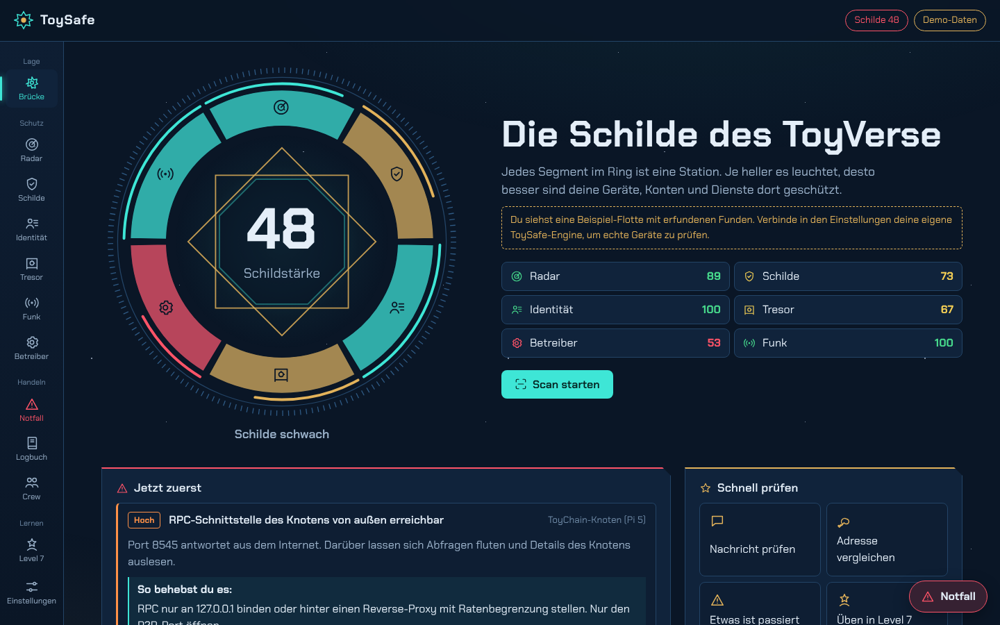
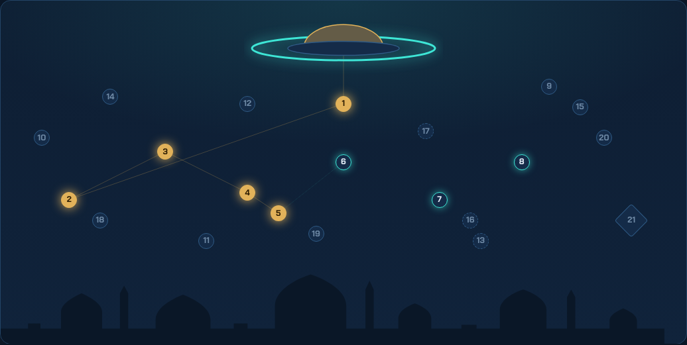
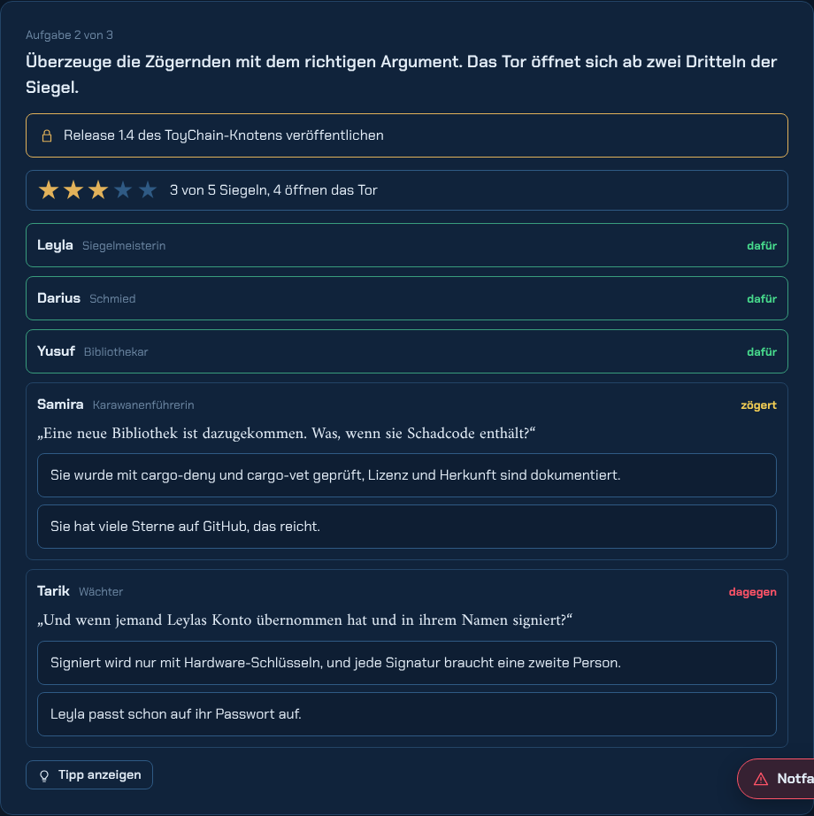

# ToySafe

**Das Sicherheits-Cockpit des ToyVerse.** ToySafe prüft eigene Geräte, Netze, Konten, Wallets, Knoten und Dienste, erklärt jeden Fund in einfachen Worten und zeigt, was zuerst zu tun ist. Dieselben Inhalte gibt es als spielbares Level 7 „Die Sternenwacht“ in TOYQUEST.



ToySafe gehört zum ToyVerse (ToyChain, TOY, TOYPAY, ToyScan, ToyCash, TOYQUEST, ToyPost). Fachlich maßgeblich für TOY sind die Dokumente in [Safehaigit/toycoin](https://github.com/Safehaigit/toycoin).

## Was ToySafe verspricht

- Prüft nur, was dir gehört. Jeder Scan braucht eine bestätigte Startfreigabe, die protokolliert wird.
- Greift nie an. Jedes Modul ruft ein bewährtes, defensives Werkzeug auf (nmap, OpenVAS, Nuclei, Lynis, testssl.sh, gitleaks, osv-scanner, trivy …) und erklärt das Ergebnis.
- Fragt nie nach Phrase oder Schlüsseln und sendet keine Transaktionen.
- Lädt nichts von Dritten. Betrugs-Detektor, Adress-Wache, Download-Prüfer und Passphrasen-Labor laufen komplett im Browser.
- Der einzige erlaubte Miner auf geprüften Geräten ist der ToyCoin-Miner aus TOYPAY.

## Stationen

| Station | Wofür |
|---|---|
| Brücke | Schildring mit Gesamtstärke, „Jetzt zuerst“, Lagebild |
| Radar | Geräte im Netz, unbekannte blinken |
| Schilde | priorisierte Funde, Scan-Konsole, Härtungs-Checklisten |
| Identität | Passphrasen-Labor und -Würfel, Zwei-Faktor, Mail-Domain-Check |
| Tresor | Adress-Wache (EIP-55, Adress-Vergiftung), Download-Prüfer (SHA-256), Grundregeln |
| Funk | Betrugs-Detektor und Link-Prüfer |
| Betreiber | ToyChain-Knoten, Webseiten, Code und Container |
| Notfall | 9 Playbooks Schritt für Schritt, Notfall-Taste auf jeder Seite |
| Logbuch | Scans und Berichte (Markdown, HTML, PDF) |
| Crew | Schutzkarten für Kinder, Großeltern, Gang und Moderation |
| Level 7 | 21 Missionen in TOYQUEST, mit Echt-Welt-Siegeln |

| Level 7: Sternenkarte | Mission mit Team-Abstimmung |
|---|---|
|  |  |

## Schnellstart

**Nur ansehen (Demo, ohne Engine):**

```bash
cd frontend
npm ci
npm run dev        # http://localhost:5173, zeigt Demo-Daten
```

**Mit eigener Engine (prüft echte Geräte):**

```bash
cd backend
python3 -m venv .venv && . .venv/bin/activate
pip install -r requirements.txt
cd ../frontend && npm ci && npm run build && cd ../backend
uvicorn toysafe.api.main:app --host 127.0.0.1 --port 8000
# Cockpit: http://127.0.0.1:8000
```

Die Engine nimmt ohne `TOYSAFE_API_TOKEN` nur Befehle vom eigenen Rechner an. Wer das Cockpit von anderen Geräten im Heimnetz öffnen will, setzt einen Zugangsschlüssel und trägt ihn im Cockpit unter Einstellungen ein.

**Kommandozeile:**

```bash
python -m toysafe.cli modules
python -m toysafe.cli scan assets.example.json --operator "Anna" --network 192.168.1.0/24 --yes --format html
python -m toysafe.cli update
```

**Docker oder systemd:** siehe `deploy/`. Für Netz-Scans aus Docker `--network host` verwenden.

## Aufbau

```
backend/    Engine in Python (FastAPI): Plugins, Priorisierung, Schildstärke, Startfreigabe, Updates, Berichte
content/    gemeinsame Inhalte: Checklisten, Playbooks, Betrugsregeln, Level 7 (missions.json)
frontend/   Cockpit (React, Vite, TypeScript): Stationen, Werkzeuge, Level 7
deploy/     Dockerfile und systemd-Dienst
docs/       Konzept, Spieldesign Level 7, Stand
```

## Prüfungen

```bash
cd backend && python -m pytest -q          # Engine und Inhalte (lösbare Missionen, gültige Regeln)
cd frontend && npm run check && npm run build
npm run preview -- --port 4173 &  npm run e2e -- http://localhost:4173   # spielt alle 21 Missionen durch (braucht Playwright)
```

## Dokumente

- [Konzept](docs/01-konzept.md): Zielgruppen, Stationen, neue Methoden, Verknüpfung im ToyVerse, offene Fragen
- [Level 7: Die Sternenwacht](docs/02-level7-sternenwacht.md): Geschichte, Missionen, Aufgaben-Typen, Teamarbeit
- [Stand](docs/STATUS.md)

## Rechtliches

ToySafe ist für autorisierte Prüfungen eigener Systeme gedacht. Unerlaubte Scans sind in vielen Ländern strafbar. ToySafe ersetzt keine Polizei und keine Rechtsberatung. Keine Anlageberatung, keine Renditeversprechen. Testnet-TOY haben keinen Wert.

Lizenz: MIT (siehe `LICENSE`). Mitgelieferte Schriften: Chakra Petch und Amiri (SIL Open Font License 1.1).
